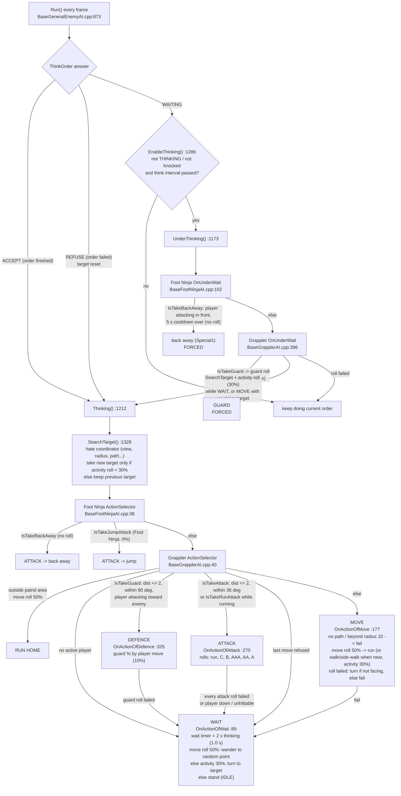

# Live Enemy AI Visualizer (Combat Lab v1.2.0 / Debug Tools v1.2.11, US)

This build adds a read-only view of what each enemy's AI actually evaluates. It does not change
enemy behaviour, timing or random numbers. It is off by default, and turning it on adds no RNG
calls and no AI calls.

## How to use it

1. Press F4 to open Debug Tools and go to the **AI VIEW** tab (it comes after COMBAT LAB).
2. Turn **AI visualizer** ON. A top-down radar appears at the right, a timeline appears along the
   bottom, and the decision panel appears under the menu (it stays on screen when the menu is closed).
3. In Combat Lab (Ctrl+Shift+L or `CombatLab.exe`), **Six Foot Ninjas test** spawns six sword Foot
   Ninjas against P1 with the lab's fixed seed and clears the statistics. Pick the AI mode
   (Vanilla / Experimental) and the Difficulty multipliers first.
4. Use **Inspect enemy** (Left/Right) to choose whose decisions are shown. The selected enemy has a gold ring on the radar.
5. **Record to TMNT2_aitrace.jsonl** writes everything to a file next to `TMNT2.exe`.
   **Write overlap summary** adds a summary line. Open the file in
   `tools/AIVisualizer/ai_replay.html` (included in the package) to replay it, scrub, export
   statistics, or compare two recordings (for example vanilla vs your multipliers).

### What is on screen

| Element | Source |
|---|---|
| Marker colour | `CEnemyCharacter::GetStatus()` grouped into categories (`CEnemyAITrace::CategoryOf`). Red = ATTACK_*/FIRE_*/THROW/JUMP_ATTACK, yellow = GUARD, blue = TURN/WALK/RUN/DASH/JUMP, gray = IDLE/THINKING, orange = Foot Ninja back-away (STATUS_SPECIAL), purple = knock/flyaway/down/getup/stun, white = appear/death/other |
| Facing line | `Compositor().GetDirection()` |
| Line to P1 | The enemy currently holds P1 as its target (last `SearchTarget` result) |
| White outline ("in range") | Same distance and front-cone test as `CBaseGrapplerAI::IsTakeAttack` (distance <= suitable distance, angle <= 36 deg x front view). The terrain "movable" test is not repeated, so in rare edge/hole cases the outline can show while the real check fails |
| Inner red ring | Foot Ninja suitable distance 2.0 |
| Think interval / since | `m_fThinkElapseTime` and `m_fTimer - m_fThinkBeforeTime` |
| Back-away cooldown | `CBaseFootNinjaAI::m_fBackAwayTimer` |
| Decision panel lines | Recorded at the real call sites, in the order the game evaluated them (see Hooks) |
| "retail" numbers | The unmodified table row / characteristic stored before multipliers (`GetDebugFrequencyRows`, `GetDebugBaseAICharacteristic`) |
| Overview counts | Per-frame status categories. "In range" uses the outline test above |
| Overlap statistics | An attack start is a change into the attack category. It counts as overlapping if another enemy was already in the attack category in that frame |

There is no "preparing to attack" colour. No status sits between choosing an attack and starting
the attack animation, so nothing real could be shown for it. A Foot Ninja's own attack recovery is
part of its ATTACK_* status, so it is red until the status changes.

## How Foot Ninja AI works (source)

Class chain: `CBaseFootNinjaAI` -> `CBaseGrapplerAI` -> `CBaseGeneralEnemyAIModerator`
(`src/Game/Component/Enemy/ConcreteAIModerator/`). Retail Foot Ninja (staff, Normal) values used below:
attack A 60, AA 50, AAA 40, B 60, C 0, run attack 30; guard vs A-chain 10, vs B 10, vs shuriken 10, vs jump 10;
thinking 0.5, activity 0.3, move 0.5, front view 1.0, action radius 10, suitable distance 2.0, impulsiveness 0.

Key facts:

* **Decisions happen at three moments.** (1) The current order ends (`ACCEPT`), for example when an
  attack animation finishes or the IDLE wait timer runs out
  (`CCommonEnemyObserver::CIdleStatus::Observing`). (2) The order fails (`REFUSE`). (3) A periodic
  check while waiting or moving ends early. That check runs at most once per
  `m_fThinkElapseTime = 1 / (frames-per-second x thinking frequency)`, which is computed once in the
  constructor (`BaseGeneralEnemyAI.cpp:863`). The panel shows the real value.
* **The action selector is driven by geometry, not chance.** Attack is chosen only when the player
  is within 2.0 units and inside a 36 deg front cone (or during a run, within 4.0). Guard is checked
  **before** attack: if the player is mid-attack, within 2.0 and facing the enemy, the enemy goes to
  DEFENCE (or the Foot Ninja backs away) and never ATTACK.
* **The attack table decides two things.** It decides *whether* the attack happens and *which*
  attack. Rolls are made in order (run attack only if eligible, then C, B, AAA, AA, A); the first
  that passes wins (`freq > RandRange(0,100)`). With retail numbers the enemy attacks about 95% of
  the time ATTACK is chosen (fails only when every roll fails: 0.4 x 0.6 x 0.5 x 0.4 = 4.8%). The
  mix is about 60% B, 16% AAA, 12% AA, 7% A. When all rolls fail, it waits.
* **Back-away has no roll.** When guard conditions hold and the 5 s cooldown is over, the Foot
  Ninja backs away (`IsTakeBackAway`) unless the spot behind it is a fall or hole.
* **No coordination code exists.** Nothing in the General AI, Grappler AI or Foot Ninja AI reads other enemies.
  The hate calculators only consider players. The `FORMATION` / `APPROACH` frequency columns are
  not read by Foot Ninja AI. There are no attack slots, no tokens and no director.

## Answers (code evidence; check the numbers with your own recordings)

**Why do Foot Ninjas stand around?** The code gives these paths to IDLE, all of which the panel labels:

1. *Move roll failed while already facing the player.* `OnActionOfMove` rolls move (50%). On a
   fail, it turns if the player is outside the 36 deg cone; otherwise it returns false
   ("Move refused: already facing"), and the enemy falls back to WAIT. So about half of all
   "approach" decisions out of range turn into a wait when the enemy already faces you.
2. *Guard chosen but the guard roll failed.* While you attack in front of it, the selector picks
   DEFENCE before ATTACK. Guard vs your move is 10% retail, so about 90% of those decisions fall
   back to WAIT. Foot Ninjas facing a player who keeps attacking mostly stand and wait. They do not
   counterattack until your attack ends or the back-away cooldown fires.
3. *Every attack roll failed* (4.8% retail) -> WAIT.
4. *Move refused* because the player is farther than the action radius (10) or unreachable
   ("no path") -> WAIT, then the next decision stays WAIT (`ActionSelector`: "last move refused").
5. *The wait itself.* A WAIT lasts up to 1.0 s (2 x thinking 0.5). It ends earlier only through the
   periodic 30% activity check (with a target), the guard reaction, or the Foot Ninja back-away. A
   wait can also be a short wander or a turn instead of standing (move 50% / activity 30% rolls in
   `OnActionOfWait`).

The decision line shows "prev order ran X s" and how many wait checks and failed activity rolls
came before each decision, so standing time can be attributed per cause.

**Do they wait for each other?** No. There is no code that reads other enemies, so an enemy never
waits because another one is attacking. Any apparent turn-taking comes from geometry (only enemies
within 2.0 and facing you can choose ATTACK, and bodies push each other apart) plus the independent
rolls.

**Can all six attack at once?** Yes. Nothing limits simultaneous attacks. The overview shows "Max at
once" and seconds with 2+ attacking. In practice, only enemies within 2.0 and facing you can choose
ATTACK.

**What prevents attacks?** In order: being outside the patrol area, having no target (the view
check, radius 10, or the activity roll when acquiring a target), guard taking priority while you
attack, distance > 2.0 or angle > 36 deg x front view, a "movable" check in front of the enemy
(wall, fall or hole), the player being down or in an unhittable state, and every attack roll
failing. Each one has its own line in the panel.

**Guard vs attack?** No roll decides between them. Guard eligibility (player attacking, within 2.0,
within 90 deg, facing each other within 72 deg) is checked first and **blocks attack** for that
decision. When guard is not eligible, the attack table applies.

**Does activity reduce idle time?** Partly. Activity (30%) is used for: taking a target when a new
one is found, the periodic "stop waiting and re-decide" roll, turning instead of standing in a wait,
and running instead of walking when close. Raising it ends waits sooner and makes waits more often
a turn. It does not touch the move-roll fail path (#1), the guard-fail path (#2) or the 1.0 s wait
length (that comes from thinking frequency).

**Does attack frequency increase attacks or only the mix?** Both, but only **after** ATTACK is
chosen. It raises the chance that a chosen ATTACK becomes an attack (retail already about 95%) and
changes the mix heavily: B is rolled before AAA/AA/A, so a 3x multiplier (capped at 99%) makes
almost every attack a B. It does not make enemies choose ATTACK more often; that comes from distance
and facing. C stays 0 because 0 x anything = 0.

**How often do attacks overlap?** The code allows any amount. Measure it with the overview ("Attack
starts N, X% while another attacked", "2+ attacking Y% of span") or the replay page's statistics. I
cannot give a number from source alone.

### Code quirks seen while tracing (not changed)

* The angle tests use `fabs(targetAngle - myDirection)` with no wrap-around. If both values are in
  -pi..pi, a target just across the +/-180 deg seam reads as nearly 360 deg off. That fails the attack
  cone and leads to a turn instead.
* `FREQUENCY_COMMON_2` (the jump-attack check) is 0 for Foot Ninjas, so the jump-attack branch never fires for them.

## Hooks (all behind `AITRACE`, compiled only with `TMNT2_DEBUG_TOOLS`, active only when enabled)

| File | Function | Records |
|---|---|---|
| `BaseGeneralEnemyAI.cpp` | `Run` | begin/end, why the decision ran (ACCEPT/REFUSE/re-decide/forced), think timers |
| | `Thinking` | selector result, each fallback to WAIT |
| | `IsSatifyFrequency` | table value and the roll it was compared with |
| | `SearchTarget` | target activity roll, impulsiveness, result |
| `BaseGrapplerAI.cpp` | `ActionSelector` | patrol run roll, eligibility flags (the same checks, evaluated once in the retail order) |
| | `OnActionOfWait` / `OnActionOfMove` / `OnActionOfAttack` | rolls and every refusal reason |
| | `OnUnderWait` | guard reaction, activity re-decide roll |
| `BaseFootNinjaAI.cpp` | `ActionSelector`, `OnUnderWait`, `OnUnderAllActions` | back-away, jump attack, cooldown |

The only control-flow edit is in `CBaseGrapplerAI::ActionSelector`. `IsTakeAttack() || IsTakeRunAttack()`
became two locals with the same short-circuit (`bTakeRunAttack` is evaluated only when attack failed),
so the calls, their order and their results are unchanged.

## Limitations

* Only enemies that use the General AI (`CBaseGeneralEnemyAIModerator` and its subclasses, which
  includes all Foot Clan grunts) get decision data. Other enemies show status, position and timeline only.
* Shooter / gunner subclasses override some handlers that are not hooked. Their attack rolls still
  appear (through `IsSatifyFrequency`), but some refusal reasons do not.
* Each decision stores up to 20 checks. A rare longer one is marked "(more checks than the panel stores)".
* 16 enemies are tracked at once; slots of removed enemies are reused.
* The JSONL file is appended to (sessions are separated by header lines) and flushed every 2 s, so
  the last 2 s can be missing if the game is killed.
* Runtime numbers in this document come from source reasoning. Your recordings give the real figures.
